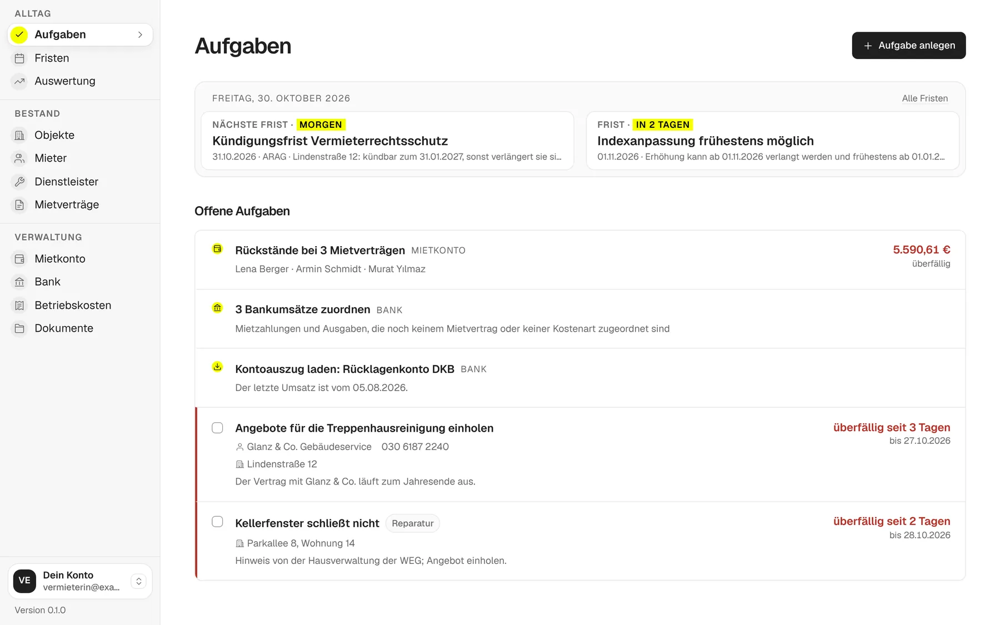
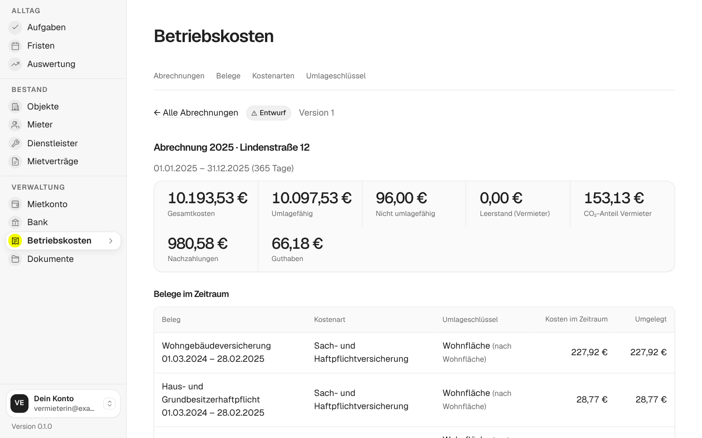

### Die Hausverwaltung von Vermietern für Vermieter.

Mietverwaltung, Bankabgleich und Betriebskostenabrechnung (Nebenkostenabrechnung) für private Vermieter an einem Ort. Open Source, nachvollziehbar gerechnet, ohne Einarbeitung und direkt mit Claude oder ChatGPT nutzbar.

 

## Funktionen

- **Betriebskostenabrechnung:** Belege erfassen, Umlageschlüssel wählen, jeder Mieter bekommt seinen Anteil mit Rechenweg als PDF.
- **Mietkonto und Bankabgleich:** Soll und Ist je Vertrag, Rückstände oben, Kontoauszüge werden per Vorschlag zugeordnet.
- **Auswertung:** Einnahmen, Ausgaben, Rendite, Cashflow und Prognose je Objekt und über alle Jahre.
- **Objekte und Einheiten:** Häuser und Eigentumswohnungen mit Flächen, Lage und Versicherungen.
- **Mieter und Mietverträge:** Vertragsdaten, Übergabe und Kaution samt Zinsen an einem Ort.
- **Index- und Staffelmiete:** Erhöhungstermine und neue Miete nach Verbraucherpreisindex automatisch berechnet.
- **Bankimport mit Regeln:** CSV gängiger Banken einlesen, wiederkehrende Umsätze ordnen sich selbst zu.
- **Zähler und Abrechnungskreise:** Verbrauch und Kosten genau den betroffenen Einheiten zuordnen.
- **Steuerübersicht:** Einnahmen und Werbungskosten nach den Zeilen der Anlage V, als PDF und CSV.
- **Dokumente:** Verträge, Belege und Schreiben direkt am Objekt oder Vertrag ablegen.
- **Aufgaben und Fristen:** Kündigungsfristen, Mieterhöhungen und Abrechnungstermine im Blick, auch im eigenen Kalender.
- **Zugänge:** Mitverwalter mit vollen Rechten oder Steuerberater mit Lesezugriff einladen.
- **KI-Assistenten:** Claude, ChatGPT und andere MCP-Clients beantworten Fragen wie „Wer ist im Rückstand?“, dazu eine REST-API. → [Anleitung](https://docs.mietkartei.de/anleitungen/ki-assistenten/)
- **Kein Lock-in:** Offener Code, Datenübernahme per CSV, vollständiger Export und Änderungsprotokoll.
- **Kein Datengeschäft:** Keine Werbung, keine Leads. Selbst betrieben kostenlos, gehostet 5 € im Monat oder 50 € im Jahr, egal wie viele Wohnungen.

## Nebenkostenabrechnung, nachgerechnet

Tagesgenau bei Mieterwechsel und Leerstand, Heizkosten nach Heizkostenverordnung, CO₂-Aufteilung nach Stufenmodell und Hinweise vor der Freigabe, etwa auf fehlende Zählerstände oder die Abrechnungsfrist. Jeder Mieter bekommt ein PDF, in dem jede Zeile zeigt, wie sein Anteil entsteht, mit dem Vergleich zum Vorjahr je Kostenart. Für die Belegeinsicht gibt es alle Belege samt Übersicht als ein ZIP.

Die [Rechenbeispiele](https://mietkartei.de/rechenbeispiele/) sind ohne mietkartei nachgerechnet und laufen bei jeder Änderung als Test: Weicht ein Cent ab, wird die Änderung nicht übernommen. Zu jedem gibt es eine [Muster-Nebenkostenabrechnung als PDF](https://mietkartei.de/rechenbeispiele/mieterwechsel/muster-nebenkostenabrechnung.pdf). → [Mehr zur Nebenkostenabrechnung](https://mietkartei.de/nebenkostenabrechnung/) · [Beispielabrechnung in der Demo](https://demo.mietkartei.de/demo?ziel=abrechnung)

## Ausprobieren: Demo oder selbst hosten

- **[Demo](https://demo.mietkartei.de):** eigener Beispielbestand mit fertiger Betriebskostenabrechnung, ohne Anmeldung.
- **[Selbst hosten](https://docs.mietkartei.de/selbst-hosten/):** kostenlos als Docker-Container auf dem eigenen Rechner oder Server, oder mit wenigen Klicks im eigenen Cloudflare-Konto für rund 5 US-Dollar im Monat an Cloudflare, ohne Server und ohne Domain. Beides mit allen Funktionen.

  

## Mitmachen

Du vermietest selbst? Dann weißt du am besten, was fehlt. Jede Hilfe zählt: Code, Fehlerberichte, Fachwissen, Texte, Gestaltung, Barrierefreiheit. Ein ⭐ hilft anderen Vermietern, es zu finden.

<b>Aufbau des Repositorys</b>

| Ordner | Inhalt |
| --- | --- |
| [`app/`](app/) | Die Anwendung: SvelteKit, Drizzle ORM und SQLite, lauffähig mit Node.js, Docker oder Cloudflare Workers |
| [`website/`](website/) | Die Startseite [mietkartei.de](https://mietkartei.de) |
| [`docs/`](docs/) | Die Dokumentation [docs.mietkartei.de](https://docs.mietkartei.de), gebaut mit Zensical |
| [`assets/`](assets/) | Logo, Schrift und der Rundgang dieser Seite (`npm run screenshots` in `app/`, dann `scripts/build_readme_animation.py`) |
| [`.github/`](.github/) | Workflows, Vorlagen sowie Anleitungen zu [Deployment](.github/DEPLOYMENT.md), [Betrieb auf einem Server](.github/SELF_HOSTING.md) und [Pflege](.github/MAINTENANCE.md) |

