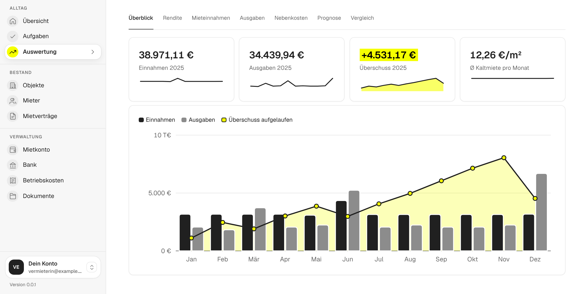
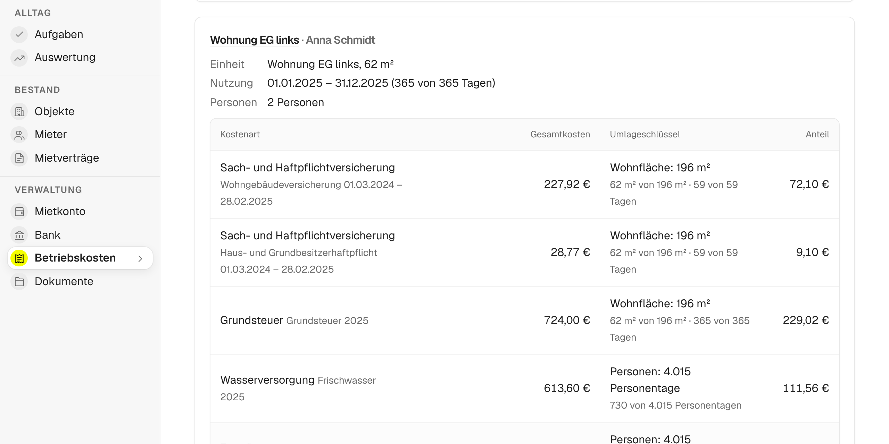
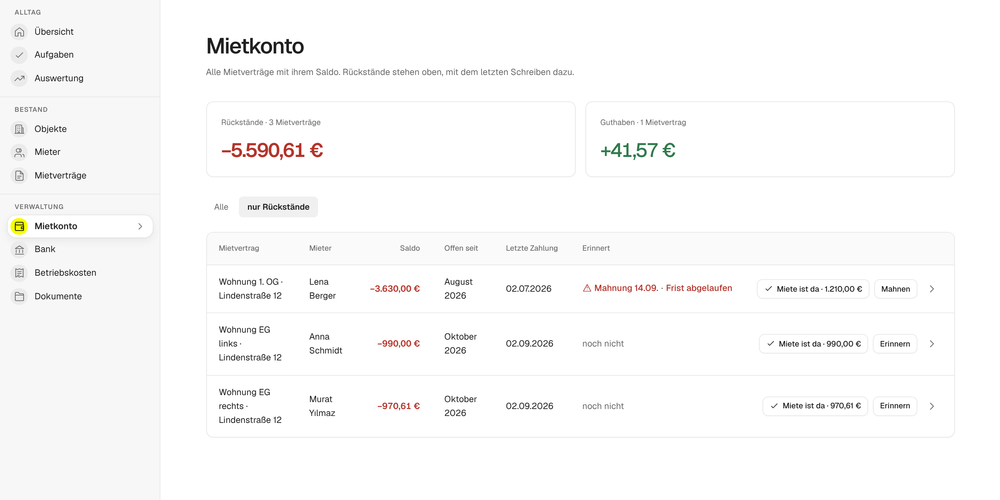

### Die Hausverwaltung von Vermietern für Vermieter.

Mietverwaltung, Bankabgleich und Betriebskostenabrechnung (Nebenkostenabrechnung) für private Vermieter an einem Ort. Open Source, nachvollziehbar gerechnet, ohne Einarbeitung und direkt mit Claude oder ChatGPT nutzbar.

 

## Warum mietkartei?

Gebaut für private Vermieter: zu klein für die großen Verwaltungsprogramme, aber mehr, als eine Excel-Tabelle sauber trägt.

- **Alles mit Rechenweg:** Jede Umlage zeigt, wie sie entsteht. Widerspricht ein Mieter, zeigst du ihm jeden Schritt.
- **Kein Lock-in:** Offener Code und vollständiger Export, deine Daten bleiben auch ohne uns nutzbar.
- **Kein Datengeschäft:** Kein Geld mit deinen Daten oder denen deiner Mieter, keine Werbung, keine Leads. Das Abo der gehosteten Version deckt Server und Weiterentwicklung.
- **Ein Preis, alles drin:** Selbst betrieben kostenlos, gehostet 8 € im Monat, egal wie viele Wohnungen.
- **Frag einfach Claude:** Über den MCP-Server beantworten Claude oder ChatGPT Fragen wie „Wer ist im Rückstand?“.

## Funktionen

### Betriebskostenabrechnung (Nebenkostenabrechnung)

Belege erfassen, Umlageschlüssel wählen, fertig. Jeder Mieter sieht, wie sich sein Anteil berechnet, und bekommt die Abrechnung als PDF.

### Mietkonto und Bankabgleich

Soll und Ist für jeden Mietvertrag. Rückstände stehen oben, Kontoauszüge ordnet mietkartei per Vorschlag den Verträgen zu.

### KI-Assistenten über MCP: Claude und ChatGPT

Verbinde Claude, ChatGPT oder einen anderen MCP-Client mit `https://app.mietkartei.de/mcp` und frag: „Wer ist mit der Miete im Rückstand?“ oder „Welche Fristen stehen in den nächsten drei Monaten an?“ Mit Schreibrechten bucht der Assistent auf Wunsch Zahlungen und erfasst Belege. Dieselben Daten gibt es als REST-API. → [KI-Assistenten anbinden](https://docs.mietkartei.de/anleitungen/ki-assistenten/)

### Weitere Funktionen

Objekte und Einheiten · Mieter und Mietverträge mit Kaution · Index- und Staffelmiete · Bankimport mit Zuordnungsregeln · Zähler und Abrechnungskreise · Dokumente · Aufgaben und Fristen · Zugänge für Mitverwalter und mit Lesezugriff · Datenübernahme per CSV · vollständiger Export · Änderungsprotokoll

## Ausprobieren: Demo oder selbst hosten

- **[Demo](https://demo.mietkartei.de):** eigener Beispielbestand mit fertiger Betriebskostenabrechnung, ohne Anmeldung, nach 24 Stunden gelöscht.
- **[Selbst hosten](https://docs.mietkartei.de/selbst-hosten/):** mit wenigen Klicks im eigenen Cloudflare-Konto für rund 5 US-Dollar im Monat an Cloudflare, ohne Server und ohne Domain, oder kostenlos als Docker-Container auf dem eigenen Rechner oder Server. Beides mit allen Funktionen.

  

## Mitmachen

Du vermietest selbst? Dann weißt du am besten, was fehlt. Jede Hilfe zählt: Code, Fehlerberichte, Fachwissen, Texte, Gestaltung, Barrierefreiheit.

**[Einstiegsaufgaben](https://github.com/OliverHennhoefer/mietkartei.de/issues?q=is%3Aissue+is%3Aopen+label%3A%22guter+einstieg%22)** · [Hilfe gesucht](https://github.com/OliverHennhoefer/mietkartei.de/issues?q=is%3Aissue+is%3Aopen+label%3A%22hilfe+gesucht%22) · [Fehler melden](https://github.com/OliverHennhoefer/mietkartei.de/issues/new?template=01-fehler.yml) · [Funktion vorschlagen](https://github.com/OliverHennhoefer/mietkartei.de/issues/new?template=02-funktionswunsch.yml) · [Frage stellen](SUPPORT.md) · [Sicherheitslücke melden](SECURITY.md)

Los geht's mit [CONTRIBUTING.md](CONTRIBUTING.md), es gilt der [Verhaltenskodex](CODE_OF_CONDUCT.md). Issues und Doku auf Deutsch, Code, Commits und Pull Requests auf Englisch. Gefällt dir mietkartei? Ein ⭐ hilft anderen Vermietern, es zu finden.

<b>Aufbau des Repositorys</b>

| Ordner | Inhalt |
| --- | --- |
| [`app/`](app/) | Die Anwendung: SvelteKit, Drizzle ORM und SQLite, lauffähig mit Node.js, Docker oder Cloudflare Workers |
| [`website/`](website/) | Die Startseite [mietkartei.de](https://mietkartei.de) |
| [`docs/`](docs/) | Die Dokumentation [docs.mietkartei.de](https://docs.mietkartei.de), gebaut mit Zensical |
| [`assets/`](assets/) | Logo, Schrift und die Bildschirmfotos dieser Seite (`npm run screenshots` in `app/`) |
| [`.github/`](.github/) | Workflows, Vorlagen sowie Anleitungen zu [Deployment](.github/DEPLOYMENT.md), [Betrieb auf einem Server](.github/SELF_HOSTING.md) und [Pflege](.github/MAINTENANCE.md) |

