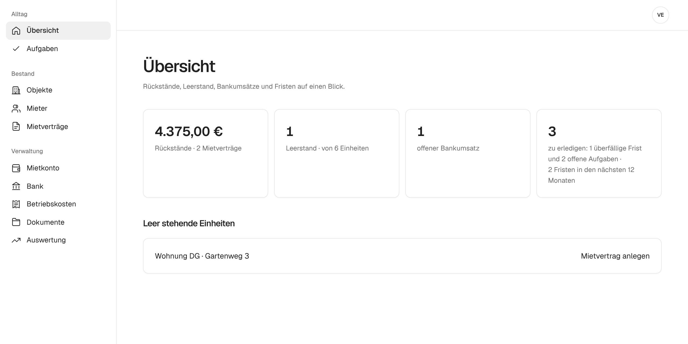

<picture>
  <source media="(prefers-color-scheme: dark)" srcset="assets/brand/lockup-white.svg">
  
</picture>

### Die Hausverwaltung von Vermietern für Vermieter.

Mieten, Bankumsätze und die Betriebskostenabrechnung für private Vermieter an einem Ort. 
Open Source, nachvollziehbar gerechnet und ohne Einarbeitung.

[**▶ Demo ausprobieren**](https://demo.mietkartei.de) · [Startseite](https://mietkartei.de) · [Dokumentation](https://docs.mietkartei.de) · [Mitmachen](CONTRIBUTING.md)

 

## Warum mietkartei?

Gebaut für Vermieter mit drei bis zehn Wohnungen: zu klein für die großen Verwaltungsprogramme, zu groß für Excel.

## So sieht es aus

**Betriebskostenabrechnung:** Belege erfassen, Umlageschlüssel wählen, fertig. Jeder Mieter sieht, wie sich sein Anteil berechnet, und bekommt die Abrechnung als PDF.

**Mietkonto:** Soll und Ist für jeden Mietvertrag. Rückstände stehen oben, Kontoauszüge ordnet mietkartei per Vorschlag den Verträgen zu.

**Außerdem dabei:** Objekte und Einheiten · Mieter und Mietverträge mit Kaution · Index- und Staffelmiete · Bankimport mit Zuordnungsregeln · Zähler und Abrechnungskreise · Dokumente · Aufgaben und Fristen · Mitverwalter · Datenübernahme per CSV · vollständiger Export · Änderungsprotokoll

## Ausprobieren

- **[Demo](https://demo.mietkartei.de):** eigener Beispielbestand mit fertiger Betriebskostenabrechnung, ohne Anmeldung, nach 24 Stunden gelöscht.
- **[Selbst hosten](https://docs.mietkartei.de/selbst-hosten/):** als Docker-Container auf dem eigenen Rechner oder Server.

## Mitmachen

Du vermietest selbst? Dann weißt du am besten, was fehlt. Jede Hilfe zählt: Code, Fehlerberichte, Fachwissen, Texte, Gestaltung, Barrierefreiheit.

**[Einstiegsaufgaben](https://github.com/OliverHennhoefer/mietkartei.de/issues?q=is%3Aissue+is%3Aopen+label%3A%22guter+einstieg%22)** · [Hilfe gesucht](https://github.com/OliverHennhoefer/mietkartei.de/issues?q=is%3Aissue+is%3Aopen+label%3A%22hilfe+gesucht%22) · [Fehler melden](https://github.com/OliverHennhoefer/mietkartei.de/issues/new?template=01-fehler.yml) · [Funktion vorschlagen](https://github.com/OliverHennhoefer/mietkartei.de/issues/new?template=02-funktionswunsch.yml) · [Frage stellen](SUPPORT.md) · [Sicherheitslücke melden](SECURITY.md)

Los geht's mit [CONTRIBUTING.md](CONTRIBUTING.md), es gilt der [Verhaltenskodex](CODE_OF_CONDUCT.md). Issues und Doku auf Deutsch, Code, Commits und Pull Requests auf Englisch. Gefällt dir mietkartei? Ein ⭐ hilft anderen Vermietern, es zu finden.

<b>Aufbau des Repositorys</b>

| Ordner | Inhalt |
| --- | --- |
| [`app/`](app/) | Die Anwendung: SvelteKit, Drizzle ORM und SQLite, lauffähig mit Node.js, Docker oder Cloudflare Workers |
| [`website/`](website/) | Die Startseite [mietkartei.de](https://mietkartei.de) |
| [`docs/`](docs/) | Die Dokumentation [docs.mietkartei.de](https://docs.mietkartei.de), gebaut mit Zensical |
| [`assets/`](assets/) | Logo, Schrift und die Bildschirmfotos dieser Seite (`npm run screenshots` in `app/`) |
| [`.github/`](.github/) | Workflows, Vorlagen sowie Anleitungen zu [Deployment](.github/DEPLOYMENT.md), [Betrieb auf einem Server](.github/SELF_HOSTING.md) und [Pflege](.github/MAINTENANCE.md) |

