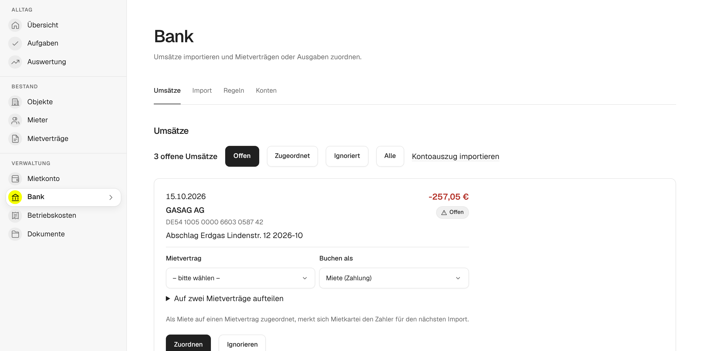

# Kontoauszüge importieren

Statt jede Mietzahlung von Hand einzutragen, importierst du deine Kontoauszüge. mietkartei schlägt vor, welche Zahlung zu welchem Mietvertrag gehört, und bucht sie aufs Mietkonto. So siehst du Rückstände sofort, und die Nebenkostenabrechnung kennt die gezahlten Vorauszahlungen.

## 1. Bankverbindung anlegen

Unter **Bank → Konten** legst du das Konto an, auf dem die Mieten eingehen, mit Name und IBAN. Hast du mehrere Konten, legst du jedes an. Führst du eine Buchhaltung, trägst du dazu die Kontonummer des Bankkontos in deinem Kontenplan ein, etwa 1200. Bei einem bestehenden Konto klickst du auf seinen Namen und ergänzt sie dort.

## 2. Kontoauszug herunterladen

Lade im Online-Banking die Umsätze des gewünschten Zeitraums herunter. Am besten eignet sich **camt.053**, ein XML-Format, das jede Bank anbietet. Oft heißt es „Kontoauszug als XML“ oder „camt“. Mehrere Dateien darfst du als ZIP hochladen.

CSV-Exporte von **Sparkasse, Volksbank, ING, DKB und comdirect** erkennt mietkartei ebenfalls. Bei anderen CSV-Dateien ordnest du zu, welche Spalte Datum, Betrag, Name und Verwendungszweck enthält. Heißen die Spalten so wie üblich, etwa „Datum“, „Betrag“, „Name“ und „Verwendungszweck“, schlägt mietkartei die Zuordnung selbst vor und zeigt gleich die Vorschau; du prüfst sie nur noch.

## 3. Importieren

Unter **Bank → Import** wählst du Bankverbindung und Datei und klickst **Datei prüfen**. Die Vorschau zeigt jede Zeile:

- **Neu:** wird übernommen.
- **Duplikat:** gibt es schon, etwa weil sich zwei Auszüge überschneiden. Wird übersprungen.
- **Regel:** wird übernommen und gleich nach einer Zuordnungsregel gebucht.
- **Ungültig:** konnte nicht gelesen werden.

Mit **Importieren** speicherst du die Umsätze.

## 4. Zuordnen

Unter **Bank → Umsätze** stehen die offenen Umsätze. Zu jedem schlägt mietkartei einen Mietvertrag vor, wenn es einen Anhaltspunkt gibt:

- dieselbe IBAN wie bei einer früheren Zahlung,
- der Name des Mieters im Verwendungszweck,
- der Name der Einheit im Verwendungszweck,
- eine Zuordnungsregel.

Passt der Vorschlag, klickst du **Zuordnen**. Ordnest du einen Umsatz als Miete einem Mietvertrag zu, merkt sich mietkartei die IBAN (ohne IBAN den Namen) als bestätigte Regel; die nächste Überweisung ordnet der Import dann selbst zu. Zahlt jemand für mehrere Mietverträge, etwa das Jobcenter, und du ordnest einen Umsatz einem anderen Vertrag zu, als die Regel sagt, wird die Regel wieder zum bloßen Vorschlag. Zahlt ein Paar mit einer Überweisung für zwei Mietverträge, etwa Wohnung und Stellplatz, teilst du den Betrag über **Zahlung für zwei Verträge? Betrag aufteilen** auf. Den Punkt gibt es nur, wenn du mehr als einen Mietvertrag hast. Ausgaben wie die Rechnung der Stadtwerke buchst du mit **Als Ausgabe buchen**, sie erscheinen dann in der Auswertung. Eine Erstattung, etwa ein Guthaben von den Stadtwerken, buchst du bei der Gutschrift mit **Als Erstattung buchen**; sie senkt die Kosten der Kategorie. Zinsen, Privatentnahmen und andere Einnahmen buchst du unter **Kapitalertrag, Privat oder sonstige Einnahme buchen**. Sie zählen weder als Mieteinnahme noch als Ausgabe. Umsätze, die nichts mit der Vermietung zu tun haben, ignorierst du.

## 5. Auf Gegenkonten buchen

Führst du deine Buchhaltung mit Kontonummern, etwa nach DATEV, legst du unter **Bank → Gegenkonten** deine Konten an: Nummer, Name, Art und, wo es passt, das Objekt. Zum Beispiel:

| Nummer | Name                 | Art                               | Objekt        |
| ------ | -------------------- | --------------------------------- | ------------- |
| 4401   | Grundsteuer          | Ausgabe, Kategorie Betriebskosten | alle          |
| 4418   | Kosten Lachnerstraße | Ausgabe, Kategorie Instandhaltung | Lachnerstraße |
| 8005   | Mieten Rudolf        | Mieteinnahmen (Kaltmiete)         | Rudolf        |
| 8006   | NK Rudolf            | Nebenkosten-Vorauszahlungen       | Rudolf        |
| 8004   | Nebenkosten Vorjahr  | Nebenkosten Vorjahr               | alle          |
| 1890   | Kapitalerträge       | Kapitalerträge                    | alle          |
| 1800   | Privatentnahmen      | Privatentnahme oder Privateinlage | alle          |

Mieten bucht mietkartei dann selbst auf die Gegenkonten des Objekts: Überweist ein Mieter 900 €, davon 700 € Kaltmiete und 200 € Vorauszahlungen, landen 700 € auf 8005 und 200 € auf 8006. Eine Teilzahlung wird im selben Verhältnis aufgeteilt. Zahlt er genau die Nachzahlung aus einer Nebenkostenabrechnung der letzten anderthalb Jahre, geht sie auf Nebenkosten Vorjahr. Kautionen gehen auf das Konto der Art Kaution. Ein Konto ohne Objekt gilt für alle Objekte, die kein eigenes Konto dieser Art haben.

Bei einer Ausgabe oder einer sonstigen Buchung wählst du das Gegenkonto selbst. Kategorie und Objekt füllt mietkartei aus dem Gegenkonto vor.

## 6. Regeln anlegen

Unter **Bank → Regeln** legst du fest, dass ein Umsatz, dessen Text etwas Bestimmtes enthält, zu einem Mietvertrag oder einem Gegenkonto gehört, etwa „Miete Gartenweg 3 links“ oder „IBAN der Stadtwerke → 4403 Stadtwerke Wasser/Müll“. Jede Regel hat einen Namen, damit du in der Liste siehst, wofür sie ist. Bestätigte Regeln buchen beim nächsten Import automatisch, unbestätigte machen nur einen Vorschlag. Eine Regel auf einen Mietvertrag bucht nur eingehende Zahlungen. Eine Regel auf ein Gegenkonto bucht beide Richtungen.

Buchst du einen Umsatz auf ein Gegenkonto, merkt sich mietkartei den Absender genauso wie bei Mieten. Zahlt derselbe Absender später auf ein anderes Konto, etwa die Stadtkasse einmal Grundsteuer und einmal Müll, wird die Regel wieder zum Vorschlag. Ausgaben ohne Gegenkonto bucht mietkartei nie automatisch.

## Bankabruf statt Datei

Wo der Bankabruf eingerichtet ist, musst du keine Kontoauszüge mehr herunterladen. Unter **Bank → Konten** klickst du beim Konto auf **Einrichten**, wählst deine Bank und gibst den Zugriff dort frei, mit derselben Anmeldung und TAN wie im Online-Banking. Den Abruf übernimmt der lizenzierte Kontoinformationsdienst [Enable Banking](https://enablebanking.com). mietkartei liest nur die gebuchten Umsätze, Überweisungen sind damit nicht möglich.

Danach holt mietkartei neue Umsätze, sobald du **Bank → Umsätze** öffnest, höchstens alle sechs Stunden. Mit **Jetzt abrufen** geht es sofort. Beim ersten Abruf kommen die letzten 90 Tage. Die Umsätze durchlaufen denselben Import wie eine Datei: Duplikate werden übersprungen, und bestätigte Regeln ordnen gleich zu. Die Freigabe gilt je nach Bank 90 bis 180 Tage, danach erneuerst du sie mit **Erneuern**. **Beenden** widerruft den Zugriff, die abgerufenen Umsätze bleiben.

Auf app.mietkartei.de gibt es den Bankabruf vorerst nicht für Abo-Konten, dort lädst du Kontoauszüge als Datei hoch. Wer mietkartei selbst betreibt, braucht dafür eine eigene Anwendung bei Enable Banking, siehe [Selbst hosten](../selbst-hosten.md).

## Weiter

Was die gebuchten Zahlungen im Mietkonto bewirken und wie die Vorauszahlungen in die Abrechnung kommen, steht unter [Nebenkostenabrechnung erstellen](nebenkostenabrechnung.md).
