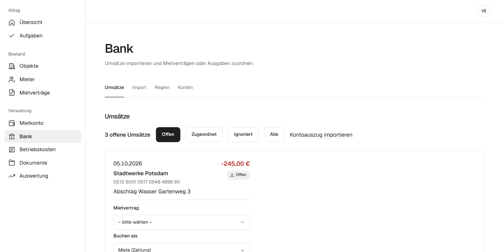

# Kontoauszüge importieren

Statt jede Mietzahlung von Hand einzutragen, importierst du deine Kontoauszüge. mietkartei schlägt vor, welche Zahlung zu welchem Mietvertrag gehört, und bucht sie aufs Mietkonto. So siehst du Rückstände sofort, und die Nebenkostenabrechnung kennt die gezahlten Vorauszahlungen.

## 1. Bankverbindung anlegen

Unter **Bank → Konten** legst du das Konto an, auf dem die Mieten eingehen, mit Name und IBAN. Hast du mehrere Konten, legst du jedes an.

## 2. Kontoauszug herunterladen

Lade im Online-Banking die Umsätze des gewünschten Zeitraums herunter. Am besten eignet sich **camt.053**, ein XML-Format, das jede Bank anbietet. Oft heißt es „Kontoauszug als XML“ oder „camt“. Mehrere Dateien darfst du als ZIP hochladen.

CSV-Exporte von **Sparkasse, Volksbank, ING, DKB und comdirect** erkennt mietkartei ebenfalls. Bei anderen CSV-Dateien ordnest du einmal zu, welche Spalte Datum, Betrag, Name und Verwendungszweck enthält.

## 3. Importieren

Unter **Bank → Import** wählst du Bankverbindung und Datei und klickst **Datei prüfen**. Die Vorschau zeigt jede Zeile:

- **Neu:** wird übernommen.
- **Duplikat:** gibt es schon, etwa weil sich zwei Auszüge überschneiden. Wird übersprungen.
- **Regel:** wird übernommen und gleich nach einer Zuordnungsregel gebucht.
- **Ungültig:** konnte nicht gelesen werden.

Mit **Importieren** speicherst du die Umsätze.

## 4. Zuordnen

Unter **Bank → Umsätze** stehen die offenen Umsätze. Zu jedem schlägt mietkartei einen Mietvertrag vor, wenn es einen Anhaltspunkt gibt:

- dieselbe IBAN wie bei einer früheren Zahlung,
- der Name des Mieters im Verwendungszweck,
- der Name der Einheit im Verwendungszweck,
- eine Zuordnungsregel.

Passt der Vorschlag, klickst du **Zuordnen**. Zahlt ein Paar mit einer Überweisung für zwei Mietverträge, etwa Wohnung und Stellplatz, teilst du den Betrag auf. Ausgaben wie die Rechnung der Stadtwerke buchst du mit **Als Ausgabe buchen**, sie erscheinen dann in der Auswertung. Umsätze, die nichts mit der Vermietung zu tun haben, ignorierst du.

## 5. Regeln anlegen

Unter **Bank → Regeln** legst du fest, dass ein Umsatz, dessen Text etwas Bestimmtes enthält, zu einem Mietvertrag gehört, etwa „Miete Gartenweg 3 links“. Bestätigte Regeln ordnen eingehende Zahlungen beim nächsten Import automatisch zu, unbestätigte machen nur einen Vorschlag. Ausgaben ordnet mietkartei nie automatisch zu.

## Weiter

Was die gebuchten Zahlungen im Mietkonto bewirken und wie die Vorauszahlungen in die Abrechnung kommen, steht unter [Nebenkostenabrechnung erstellen](nebenkostenabrechnung.md).
