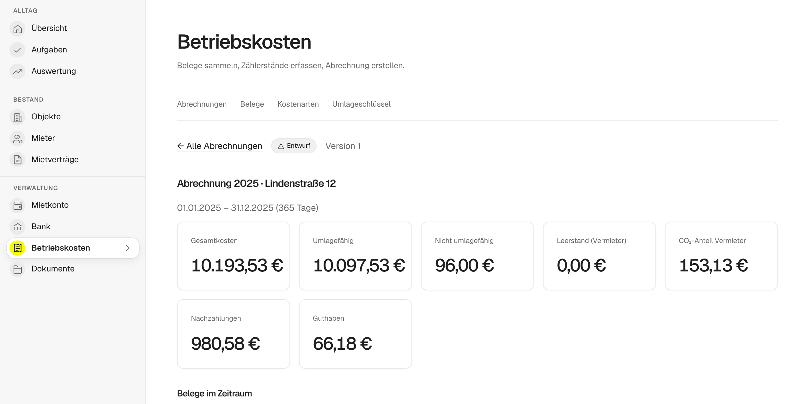

# Nebenkostenabrechnung erstellen

Die Nebenkostenabrechnung, genauer Betriebskostenabrechnung, verteilt die Kosten eines Hauses auf die Mieter und verrechnet sie mit den Vorauszahlungen. In mietkartei erfasst du dafür die Rechnungen des Jahres. Den Rest rechnet mietkartei und zeigt zu jedem Betrag den Rechenweg.

## Bevor du anfängst

Die Abrechnung braucht drei Dinge, die du einmal anlegst und danach jedes Jahr wiederverwendest:

- **Objekt und Einheiten** mit Wohnfläche, unter **Objekte**.
- **Mietverträge** mit Beginn, gegebenenfalls Ende, Personenzahl und monatlicher Vorauszahlung auf Betriebs- und Heizkosten, unter **Mietverträge**.
- **Zähler und Zählerstände**, falls du Kosten nach Verbrauch verteilst, im Objekt unter **Zähler**.

Die gezahlten Vorauszahlungen liest mietkartei aus dem Mietkonto. Wenn du deine [Kontoauszüge importierst](kontoauszuege-importieren.md), stimmen sie ohne weitere Arbeit.

## 1. Umlageschlüssel prüfen

Jede Kostenart hat einen Standardschlüssel: Heizung und Warmwasser nach Verbrauch und Fläche (70/30), alles andere nach Wohnfläche. Brauchst du etwas anderes, etwa Müll nach Personen, änderst du das einmal bei der Kostenart, bevor du die Belege erfasst. Jeder Beleg übernimmt den Schlüssel beim Speichern. Bei Belegen, die du schon erfasst hast, änderst du den Schlüssel im Beleg selbst. Welche Schlüssel es gibt und wann welcher passt, steht unter [Umlageschlüssel](umlageschluessel.md).

## 2. Belege erfassen

Unter **Betriebskosten → Belege → Beleg erfassen** trägst du jede Rechnung ein: Objekt, Kostenart, Zeitraum und Betrag, auf Wunsch mit dem eingescannten Beleg. Die 17 Kostenarten aus § 2 Betriebskostenverordnung sind vorbelegt, etwa Grundsteuer, Wasser, Müllabfuhr, Gebäudeversicherung oder Hausmeister.

Mit **Speichern und nächsten Beleg** bleiben Objekt und Zeitraum für die nächste Rechnung stehen. Ab dem zweiten Jahr bietet dir das Formular die Belege der Vorjahre zum Übernehmen an, sodass du oft nur noch den Betrag änderst.

Eine Rechnung, die nicht genau das Abrechnungsjahr abdeckt, etwa eine Versicherung von Juli bis Juni, rechnet mietkartei tagesgenau auf den Abrechnungszeitraum herunter.

## 3. Entwurf erstellen und prüfen

Unter **Betriebskosten → Abrechnungen** wählst du Objekt und Zeitraum und klickst **Entwurf erstellen**. Der Zeitraum darf höchstens zwölf Monate lang sein.

Der Entwurf zeigt oben die Summen: Gesamtkosten, umlagefähige Kosten, den Anteil des Leerstands und den CO₂-Anteil des Vermieters. Darunter steht für jeden Mietvertrag, welche Kosten mit welchem Schlüssel auf ihn entfallen, welche Vorauszahlungen er geleistet hat und ob eine Nachzahlung oder ein Guthaben herauskommt.

Dabei gilt:

- **Tagesgenau:** Zieht ein Mieter im Mai aus, trägt er die Kosten bis zu seinem Auszugstag, der Nachmieter ab seinem Einzug. Steht die Wohnung dazwischen leer, trägst du diesen Anteil selbst.
- **Personen über die Zeit:** Ändert sich die Personenzahl im Jahr, rechnet mietkartei mit Personentagen.
- **CO₂-Kosten:** Bei Heizöl und Erdgas teilt mietkartei die CO₂-Kosten nach dem Stufenmodell des CO₂-Kostenaufteilungsgesetzes auf. Mehr dazu steht im Artikel [CO₂-Kosten aufteilen](https://mietkartei.de/neuigkeiten/co2-kosten-aufteilen/).
- **Hinweise:** Fehlen Zählerstände, ist der Verbrauchsanteil der Heizkosten ungewöhnlich oder droht die Abrechnungsfrist abzulaufen, zeigt der Entwurf einen Hinweis mit einem Link zur Stelle, an der du es behebst.

Ein Entwurf rechnet bei jedem Öffnen neu. Fehlt ein Beleg, trägst du ihn nach und öffnest den Entwurf wieder.

## 4. Freigeben und zustellen

Stimmt alles, klickst du **Freigeben**. Ab dann ändert sich die Abrechnung nicht mehr, und Nachzahlungen und Guthaben werden auf den Mietkonten gebucht. Für jeden Mietvertrag steht dann ein PDF mit Kostenaufstellung, Umlageschlüsseln, CO₂-Angaben und Vorauszahlungen bereit.

Die Freigabe verschickt nichts. Lade die PDFs herunter und stell sie deinen Mietern selbst zu, per Post, per E-Mail oder persönlich. Trag danach ein, wann die Abrechnung beim Mieter angekommen ist. Davon hängen zwei Fristen ab:

- **Abrechnungsfrist:** Die Abrechnung muss dem Mieter spätestens zwölf Monate nach Ende des Abrechnungszeitraums zugehen (§ 556 Abs. 3 BGB). Kommt sie später an, kannst du eine Nachzahlung in der Regel nicht mehr verlangen. mietkartei bucht sie dann wieder aus.
- **Einwendungsfrist:** Der Mieter kann bis zum Ende des zwölften Monats nach Zugang Einwände erheben.

Eine Nachzahlung wird 30 Tage nach Zugang fällig.

## 5. Vorauszahlungen anpassen

Zu jedem Mietvertrag schlägt die Abrechnung eine neue monatliche Vorauszahlung vor, ein Zwölftel der Jahreskosten (§ 560 Abs. 4 BGB). Mit **Vorauszahlung anpassen** übernimmst du sie in den Mietvertrag.

## Fehler entdeckt?

Eine freigegebene Abrechnung bleibt, wie sie ist. Mit **Korrektur erstellen** legst du einen neuen Entwurf mit den aktuellen Belegen an. Nach der Freigabe der Korrektur bucht mietkartei nur den Unterschied zur ersten Version.

## Ausprobieren

In der [Demo](https://demo.mietkartei.de) liegt eine fertige Abrechnung für ein Beispielhaus. Dort kannst du jeden Schritt ohne Anmeldung durchklicken.
