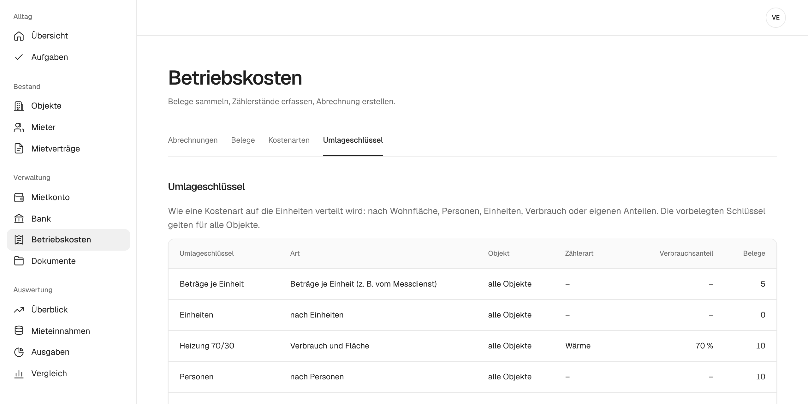

# Umlageschlüssel

Der Umlageschlüssel legt fest, wie eine Kostenart in der Nebenkostenabrechnung auf die Wohnungen verteilt wird. Steht im Mietvertrag nichts anderes, gilt nach § 556a BGB die Wohnfläche. Für Heizung und Warmwasser schreibt die Heizkostenverordnung vor, dass ein Teil nach Verbrauch verteilt wird.

## Die Schlüssel in mietkartei

Unter **Betriebskosten → Umlageschlüssel** sind diese Schlüssel vorbelegt. Sie gelten für alle Objekte:

| Schlüssel | Verteilt nach | Typisch für |
| --- | --- | --- |
| Wohnfläche | Quadratmetern der Einheit | Grundsteuer, Versicherung, Gartenpflege, Hausmeister |
| Personen | Personentagen laut Mietvertrag | Müllabfuhr, Wasser ohne Wohnungszähler |
| Einheiten | gleichen Teilen je Einheit | Kabelanschluss, Wartung je Wohnung |
| Heizung 70/30 | 70 % Wärmeverbrauch, 30 % Fläche | Heizkosten |
| Warmwasser 70/30 | 70 % Warmwasserverbrauch, 30 % Fläche | Warmwasserkosten |
| Beträge je Einheit | Beträgen, die du je Einheit einträgst | Abrechnungen vom Messdienst |

Den Verbrauchsanteil darfst du nach Heizkostenverordnung zwischen 50 und 70 Prozent wählen. Liegt er außerhalb, weist der Entwurf der Abrechnung darauf hin.

Hat eine Einheit im Zeitraum des Belegs den Mieter gewechselt oder stand sie leer, fragt der Beleg beim Schlüssel **Beträge je Einheit** die Beträge je Mietvertrag ab, so wie sie der Messdienst nach der Zwischenablesung ausweist (§ 9b Heizkostenverordnung). Was auf den Leerstand entfällt, trägst du nicht ein; es bleibt bei dir. Gibt es keine Zwischenablesung, trägst du stattdessen den Betrag der ganzen Einheit ein; er wird dann nach Tagen auf die Mietverträge und den Leerstand verteilt.

## Eigene Schlüssel anlegen

Unten auf derselben Seite legst du weitere Schlüssel an. Zur Wahl stehen:

- **nach Verbrauch** oder **Verbrauch und Fläche** mit einer Zählerart (Kaltwasser, Warmwasser, Wärme, Gas oder Strom). Der Verbrauch kommt aus den Zählerständen, die du im Objekt unter **Zähler** erfasst.
- **eigene Anteile** für ein Objekt, zum Beispiel Miteigentumsanteile. Die Anteile je Einheit trägst du danach im Schlüssel ein.

## Schlüssel einer Kostenart festlegen

Unter **Betriebskosten → Kostenarten** hat jede Kostenart einen Standardschlüssel, den jeder neue Beleg übernimmt. Für einzelne Belege kannst du einen anderen Schlüssel wählen.

Teilen sich nicht alle Einheiten eines Hauses eine Kostenart, etwa der Aufzug, den die Erdgeschosswohnungen nicht nutzen, legst du im Objekt einen **Abrechnungskreis** mit den betroffenen Einheiten an und ordnest ihn der Kostenart oder dem Beleg zu.

## Leerstand

Auch eine leere Wohnung bekommt ihren Anteil. Diesen Anteil trägst du als Vermieter, er wird nicht auf die anderen Mieter umgelegt. Die Abrechnung weist ihn als „Leerstand (Vermieter)“ aus. Beim Schlüssel nach Personen zählt eine leere Wohnung mit der Personenzahl, die du im Objekt unter „Personen bei Leerstand“ einträgst.

## Weiter

Wie die Schlüssel in der Abrechnung zusammenkommen, zeigt [Nebenkostenabrechnung erstellen](nebenkostenabrechnung.md).
