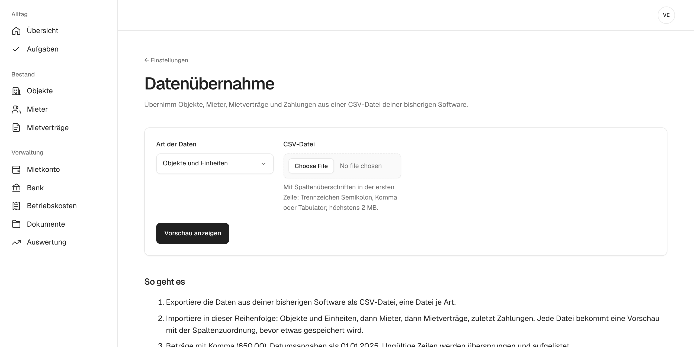

# Von Excel umsteigen

Viele Vermieter führen ihre Wohnungen in einer Excel-Tabelle, bis die Nebenkostenabrechnung zu aufwendig wird. Was in der Tabelle steht, übernimmst du per CSV-Datei in mietkartei. Danach rechnet mietkartei Soll und Ist jedes Mietkontos selbst.

## 1. CSV-Dateien speichern

Speichere in Excel jede Tabelle mit **Datei → Speichern unter → CSV UTF-8** oder „CSV (Trennzeichen-getrennt)“. Nötig ist eine Datei je Art von Daten, mit Spaltenüberschriften in der ersten Zeile. Semikolon, Komma und Tabulator als Trennzeichen funktionieren. Beträge schreibst du mit Komma (650,00), Datumsangaben als 01.01.2025.

Was in welche Datei gehört:

- **Objekte und Einheiten:** eine Zeile je Einheit mit Objekt, Straße, PLZ, Ort, Einheit, Art und Fläche. Zeilen mit demselben Objekt und derselben Straße werden zu einem Objekt.
- **Mieter:** eine Zeile je Mieter mit Anrede, Vorname, Nachname, E-Mail, Telefon und Adresse.
- **Mietverträge:** eine Zeile je Vertrag mit Objekt, Einheit, Mieter, Beginn, Ende, Kaltmiete, Betriebs- und Heizkostenvorauszahlung, Kaution, Personen, „Mietkonto ab“ und Anfangssaldo. Mehrere Mieter eines Vertrags trennst du mit „;“.
- **Zahlungen:** eine Zeile je Zahlung mit Objekt, Einheit, Datum, Betrag und Verwendungszweck.

Die Spaltennamen müssen nicht genau so heißen. Du ordnest sie beim Import zu.

## 2. In der richtigen Reihenfolge importieren

Öffne **Einstellungen → Datenübernahme** und importiere nacheinander:

1. Objekte und Einheiten
2. Mieter
3. Mietverträge
4. Zahlungen

Die Reihenfolge ist wichtig, weil ein Mietvertrag auf Einheit und Mieter verweist, die es dann schon geben muss.

## 3. Spalten zuordnen und Vorschau prüfen

Nach dem Hochladen schlägt mietkartei vor, welche Spalte welches Feld füllt. Du korrigierst, was nicht passt, und siehst eine Vorschau, bevor etwas gespeichert wird. Zeilen, die nicht passen, etwa mit einem ungültigen Datum, werden übersprungen und mit Grund aufgelistet. Du korrigierst sie in der Tabelle und importierst die Datei erneut. Objekte und Mieter, die es schon gibt, legt mietkartei nicht doppelt an.

## 4. Anfangssaldo und Mietkonto

Damit Rückstände von Anfang an stimmen, gibst du je Mietvertrag an, ab wann das Mietkonto in mietkartei läuft („Mietkonto ab“) und welcher Saldo zu diesem Tag offen war. Ältere Zahlungen musst du nicht übernehmen.

## Danach

Für neue Zahlungen musst du nicht mehr tippen: [Kontoauszüge importieren](kontoauszuege-importieren.md). Wenn das Jahr um ist, hilft [Nebenkostenabrechnung erstellen](nebenkostenabrechnung.md).

Du willst erst schauen, ob sich der Umstieg lohnt? Die [Demo](https://demo.mietkartei.de) zeigt einen fertigen Bestand ohne Anmeldung.
